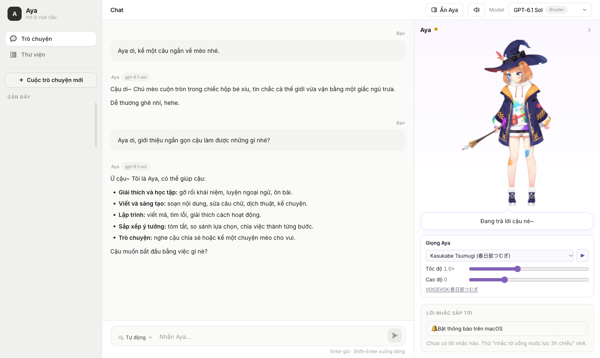
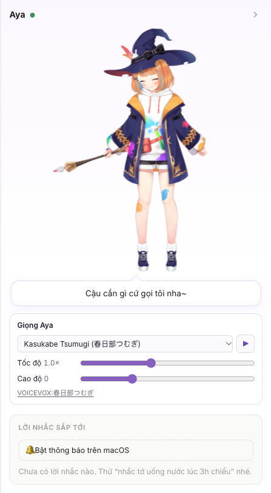

# Aya

**Aya is a local-first personal AI assistant with an anime soul: she reads and
discusses your documents, works with your files, the web, code and your Mac —
and talks back with a voice and a Live2D face.**



Aya is built for conversations that move naturally between papers, side topics,
follow-up questions, tables, figures, and comparisons—without losing track of
which document the user is talking about.

Unlike a basic “chat with PDF” interface, Aya combines a persistent
conversation state, structured document retrieval, graph navigation, visual
understanding, and evidence validation in one desktop agent.

## What Aya can do

### A character, not a chat box

Aya lives on her own stage beside the chat: a Live2D character (Mao) with
expressions for thinking, working, waiting for approval and finishing, idle
gestures, dozing off when left alone, and reactions when poked. While an answer
streams she turns to read it; when voice is on she speaks it sentence by
sentence, her mouth follows the real audio level, and she nods along. Zoom and
pan the stage, or hide it from the top bar.



### A voice you choose

A local TTS sidecar gives Aya three kinds of voices, picked in the app:
25 Vietnamese voices (VieNeu-TTS v3 Turbo), Vietnamese with the timbre of
VOICEVOX anime characters (cloned from short reference clips), and real
Japanese VOICEVOX voices (the answer is translated before it is spoken). Every
character voice shows its credit. The engines load offline in about ten seconds.

### An agent that finishes what you ask

Give Aya a goal and she turns it into a task: a plan, steps with tools, a budget,
and a report at the end. Tasks run in the background, survive a backend restart,
ask you when something essential is missing (your answer continues the same
task), and notify you in the app, on macOS or on Telegram when they are done.
Answers and tool cards stream as they are written. On a sealed 30-task agent
suite she completed **27/30 (90%) with 0 unauthorised side effects**.

### A personal assistant with tools

Aya can search and read the web, work with files in her workspace, run Python
and shell commands in a macOS Seatbelt sandbox, set reminders that reach you as
macOS notifications, use Apple Reminders, Calendar and Notes, open apps and
links, and control Spotify. Anything with side effects after reading untrusted
content asks for your approval first.

### Talk naturally about documents

Ask questions in Vietnamese or English without repeatedly restating the full
paper name. Aya keeps track of the active paper, recently discussed documents,
topics, and multi-paper references such as “the previous paper”, “those two”,
or “compare it with ASPIRE”.

You can leave the paper discussion, talk about something else, and return later
without manually rebuilding the context.

### Retrieve the right kind of evidence

Aya does not treat every question as plain text search. It can retrieve:

- passages and section-level context;
- canonical tables and individual result rows;
- figures, architecture diagrams, and page images;
- dataset, method, contribution, training, ablation, and limitation evidence;
- evidence from multiple papers for comparison or synthesis.

Exact table and figure requests are resolved against canonical document
artifacts instead of guessed from model-generated text.

### Understand papers beyond text chunks

Documents are parsed into structural parent–child chunks, tables, figures, and
page-aware artifacts. Figure descriptions are enriched with the paper summary,
page context, nearby captions, and surrounding content so a cropped panel or a
publisher logo is less likely to be mistaken for a meaningful research figure.

Aya uses LightRAG as a navigation graph and grounds final answers back to
canonical document evidence. Graph entities help find relationships; they are
not silently promoted into factual evidence.

### Compare multiple papers without mixing them up

Multi-paper questions are retrieved and validated per document. Aya preserves
document ownership for metrics, tables, methods, and claims, then synthesizes
the comparison only after the required papers are covered.

This prevents a baseline mentioned inside one paper from being mistaken for the
active paper, and prevents a number from one result table from being assigned to
another model or document.

### Refuse unsupported quantitative claims

Aya is designed to abstain when the retrieved evidence cannot support a number,
metric, parameter count, or comparison. Its evidence validator understands
scientific-table structures, metric aliases, hierarchical headers, and common
Markdown/Docling extraction formats.

The goal is simple: **retrieve the evidence, preserve its ownership, then
answer—never invent a plausible-looking result.**

### Remember across conversations

Aya's memory is split into complementary layers:

- **L0 — full history:** durable messages and searchable past episodes;
- **L1 — working state:** active papers, recent document threads, and topic;
- **L2 — conversation memory:** rolling summary, pending turns, and relevant
  recent context;
- **L3 — long-term memory:** validated semantic, episodic, and procedural
  memories with provenance.

Memory folding runs in the background and is designed to survive restarts,
concurrent messages, quota errors, and delayed summaries without dropping the
raw turns that have not been folded yet.

## How Aya works

```text
User
  │
  ▼
Conversation state + intent + document scope
  │
  ├── Canonical tables / figures / pages
  ├── Hybrid text retrieval (FTS5 + LanceDB)
  ├── Parent–child structural context
  ├── Evidence cards by paper facet
  └── LightRAG graph navigation
  │
  ▼
Per-document evidence validation
  │
  ▼
GPT-6.1 Sol through 9router
  │
  ▼
Grounded answer + sources + visual/table artifacts
```

Answers use `cx/gpt-6.1-sol` and routing uses `cx/gpt-6-luna`, both through
9router. Aya does not silently switch to a different answer model when the
selected provider fails.

Local EmbeddingGemma embeddings power the current vector index. Ollama is used
for embedding infrastructure, not as an automatic replacement for the main
agent model.

## Architecture

| Layer | Technology |
|---|---|
| Desktop | Tauri, React, TypeScript, Vite |
| Agent API | FastAPI, LangGraph, SSE streaming |
| Main model gateway | 9router: `cx/gpt-6.1-sol` answers, `cx/gpt-6-luna` routing |
| Avatar | Live2D Cubism (pixi-live2d-display), Mao model |
| Voice | TTS sidecar: VieNeu-TTS v3 Turbo (ONNX/CPU) + VOICEVOX core |
| Agent | Persistent tasks (plan → execute → re-plan), background worker with restart resume, approvals, budgets |
| Tools | 30: web, files, sandboxed code, reminders, macOS apps, Spotify, memory, notifications, Telegram |
| Retrieval | SQLite FTS5, LanceDB, LightRAG |
| Embeddings | EmbeddingGemma-300M (local, via Ollama) |
| Document processing | Docling-based text, table, page, and figure pipeline |
| Memory and provenance | SQLite |

Document questions run through a controlled research pipeline; everything else
goes to a tool loop with per-tool permissions and approvals. This keeps
document scope, evidence boundaries and side effects explicit.

## Run Aya locally

Requirements:

- Python 3.11+
- Node.js and npm
- 9router on port `20128`
- Ollama with `embeddinggemma:300m`

```bash
# Terminal 1 — model gateway
9router -n -l -p 20128

# Terminal 2 — backend
cd backend
cp ../.env.example .env
.venv/bin/uvicorn app.main:app --host 127.0.0.1 --port 7777

# Terminal 3 — desktop web UI
cd apps/desktop
npm install
npm run dev
```

Voice is optional: create the sidecar environment and download the models once
(see [`services/tts/README.md`](services/tts/README.md)); the backend then starts
and supervises it on port `7801`.

Aya keeps local papers, extracted artifacts, indexes, chat databases, model
weights, and real environment files outside version control.

## Project status

- **RAG v1** released 2026-10-22: sealed multi-format evaluation 85.3% / 86.5%
  correct, **0 fabricated numbers**.
- **Agent core (P1)** gate passed 2026-10-29: 27/30 tasks, 0 unauthorised side
  effects.
- Router bypass for document-free turns: merged behind a flag, validated without
  RAG regression.
- Next: [deep research](docs/plans/agent/08-DEEP-RESEARCH.md).

Per-item verdicts are in [`evals/results/`](evals/results/README.md). The full
picture is in [`docs/PROJECT-OVERVIEW.md`](docs/PROJECT-OVERVIEW.md).

Tests: **2,268 backend tests** and 41 voice-sidecar tests pass. The desktop
production build is green.

Credits: Live2D sample model Mao © Live2D Inc. (Free Material License);
VieNeu-TTS (Apache-2.0); VOICEVOX voices — each character's credit is shown
in the app (e.g. `VOICEVOX:春日部つむぎ`).
